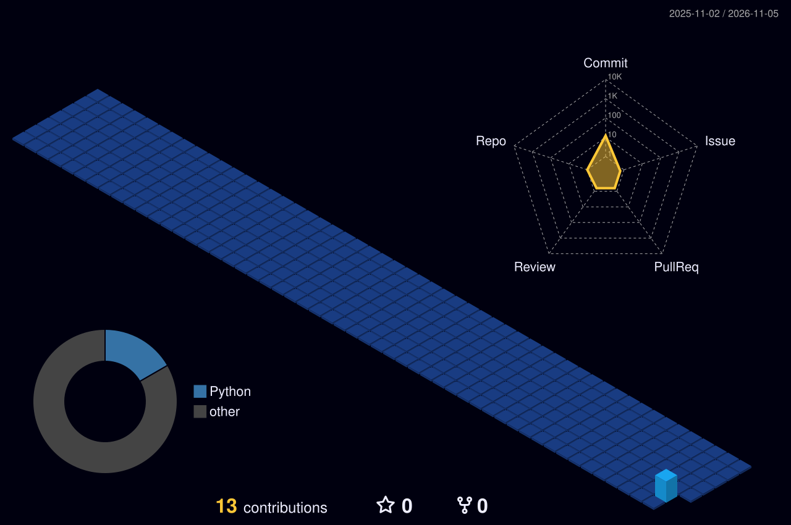

<!-- ═══════════════════════════════════════════════════════════════════ -->
<!-- 🏟️ HERO: ANIMATED STADIUM COMMAND CENTER                           -->
<!-- ═══════════════════════════════════════════════════════════════════ -->

  

<!-- ═══════════════════════════════════════════════════════════════════ -->
<!-- ⚡ LIVE DYNAMIC TYPING ANIMATION (007 GOLD & RED)                   -->
<!-- ═══════════════════════════════════════════════════════════════════ -->

  

<!-- ═══════════════════════════════════════════════════════════════════ -->
<!-- 🎖️ QUICK MATCH BADGES                                               -->
<!-- ═══════════════════════════════════════════════════════════════════ -->

  

<!-- ═══════════════════════════════════════════════════════════════════ -->
<!-- 🪪 PLAYER REGISTRATION CARD & LIVE DOSSIER                         -->
<!-- ═══════════════════════════════════════════════════════════════════ -->

  

 

<!-- ═══════════════════════════════════════════════════════════════════ -->
<!-- 🏏 SECTION 1: ABOUT ME & THE PLAYING PHILOSOPHY                     -->
<!-- ═══════════════════════════════════════════════════════════════════ -->

  

 

### 🧠 My Core Engineering Philosophy

> *"In cricket, you don't step out to swing blindly at every delivery. You read the pitch, analyze the situation, and select the right shot.*
>
> **Good engineering isn't about writing more code. It's about making better decisions.**"

> ### 👑 The #18 Chase Master Philosophy
> *"As long as there's a 1% chance, there is 100% belief."*
>
> When production is burning, the required run rate is 15 an over, and everyone else is panicking — **that's when you stay in the middle**. You don't slash recklessly. You break down the problem ball by ball, absorb the pressure, calculate the angles, and systematically chase down the target.
>
> **Fire in the belly. Ice in the head. Uncompromising loyalty to the process.**

I am **Vandan Mahajan**, a Software Engineer based in **Bengaluru**, focused on **Systems × Product × AI**.

I don't define myself merely as a "Java Developer" or a "Backend Engineer." My strongest skill is **problem solving through logic, common sense, reasoning, and engineering judgment.**

Before writing any code, I ask:
- **What is actually the problem?** (Stripping away surface symptoms)
- **Why does it exist right now?**
- **What assumptions are being made?**
- **What can go wrong?** (Edge cases, failure modes, race conditions)
- **What is the simplest logical solution?**
- **How will it behave at scale?**
- **Does this solution make practical sense?**

**LOGIC × COMMON SENSE × PROBLEM SOLVING × ENGINEERING**

 

  

 

### 💡 The Common Sense Rules I Build By:
* **Practical Reality > Theoretical Perfection:** A solution must solve the actual business constraint, not satisfy developer vanity.
* **If It Feels Too Complex, It's Wrong:** The right engineering decision usually feels obvious in retrospect. If you need 10 moving parts where 2 would do, strip it down.
* **Question the Underlying Assumptions:** Don't write 500 lines of code to fix a flawed requirement that shouldn't exist in the first place.
* **The 03:00 AM Test:** If a system fails in the middle of the night, can an engineer diagnose it within 5 minutes, or does it fail silently and catastrophically?
* **Common Sense Over Cleverness:** Adding a microservice or an extra broker queue does not solve a missing database index. Understand the fundamentals first.

---

  

<!-- ═══════════════════════════════════════════════════════════════════ -->
<!-- 🛡️ SECTION 2: Q-BRANCH ARSENAL // THE PLAYING XI                    -->
<!-- ═══════════════════════════════════════════════════════════════════ -->

  

 

### 🛠️ Q-Branch Technical Arsenal (The Playing XI)

| Discipline | Core Technologies | Applied Experience |
| :--- | :--- | :--- |
| **☕ Backend Engineering** | **Java (17 / 21)**, **Spring Boot** | Spring MVC, JPA, Hibernate, Python, Node.js |
| **🗄️ Databases &amp; Storage** | **PostgreSQL**, **MySQL** | MongoDB, Schema Design, Index Tuning |
| **⚡ Distributed Systems &amp; Infra** | **Redis (Cache / Distributed Locks)**, **Apache Kafka** | RabbitMQ, Docker, AWS, Jenkins, Linux |
| **🤖 Generative AI &amp; LLMs** | **LLM Applications**, **RAG Architecture** | Vector Embeddings, ChromaDB, Ollama Local Models |
| **💻 Frontend &amp; Interface** | **React**, **JavaScript (ES6+)** | Vite, Operator Dashboards, REST APIs |

 

  

---

  

<!-- ═══════════════════════════════════════════════════════════════════ -->
<!-- 📐 SECTION 3: ENGINEERING IDENTITY // HOW I THINK & BUILD           -->
<!-- ═══════════════════════════════════════════════════════════════════ -->

  

 

### 🎯 What I Enjoy Building

- **Backend Engineering &amp; High-Throughput APIs:** Designing clean, maintainable microservices with strong type safety and robust contracts.
- **Distributed Systems &amp; Scalability:** Event-driven architecture with Kafka, distributed caching with Redis, and resilient system boundaries.
- **Database Design &amp; Performance Optimization:** Index optimization, query execution plan analysis, and avoiding connection starvation.
- **Generative AI &amp; RAG Systems:** Building retrieval-augmented generation pipelines that ground LLMs with actual facts, hybrid search, and local inference via Ollama.
- **Practical Engineering Judgment:** Stripping away unnecessary frameworks and accidental complexity to build software that is easy to understand, test, and scale.

---

  

<!-- ═══════════════════════════════════════════════════════════════════ -->
<!-- 🍸 SECTION 4: CLASSIFIED MISSIONS // FEATURED PROJECTS             -->
<!-- ═══════════════════════════════════════════════════════════════════ -->

## 🍸 Classified Missions // Match Highlights

<table>
  <thead>
    <tr style="border-bottom: 2px solid #D31427;">
      <th align="left" width="25%">Fixture / Project</th>
      <th align="left" width="45%">What It Is</th>
      <th align="left" width="20%">Tech Stack</th>
      <th align="center" width="10%">Link</th>
    </tr>
  </thead>
  <tbody>
    <tr>
      <td><b>⚡ Distributed Ledger Engine</b></td>
      <td>High-throughput distributed event streaming and transaction ledger with partitioned ordering and write-back caching.</td>
      <td><code>Java 21</code> <code>Spring Boot</code> <code>Kafka</code> <code>Redis</code></td>
      <td align="center"><a href="https://github.com/vandan-mahajan"><b>Code ↗</b></a></td>
    </tr>
    <tr>
      <td><b>🧠 Hybrid RAG Knowledge Pipeline</b></td>
      <td>Context-aware document intelligence system combining dense vector search and sparse keyword retrieval with local LLM streaming.</td>
      <td><code>Python</code> <code>ChromaDB</code> <code>Ollama</code> <code>FastAPI</code></td>
      <td align="center"><a href="https://github.com/vandan-mahajan"><b>Code ↗</b></a></td>
    </tr>
    <tr>
      <td><b>🛡️ Distributed Cache Gateway</b></td>
      <td>Resilient caching gateway engineered with mutual exclusion locks and early probabilistic expiration to eliminate cache stampedes.</td>
      <td><code>Java</code> <code>Spring Boot</code> <code>Redis</code> <code>MySQL</code></td>
      <td align="center"><a href="https://github.com/vandan-mahajan"><b>Code ↗</b></a></td>
    </tr>
    <tr>
      <td><b>📦 Transactional Outbox Service</b></td>
      <td>Guaranteed at-least-once message delivery pipeline syncing database state to event brokers without dual-write anomalies.</td>
      <td><code>PostgreSQL</code> <code>Kafka</code> <code>Docker</code> <code>Java</code></td>
      <td align="center"><a href="https://github.com/vandan-mahajan"><b>Code ↗</b></a></td>
    </tr>
  </tbody>
</table>

 

  <a href="https://github.com/vandan-mahajan?tab=repositories"><b>→ See all repositories on GitHub</b></a>

---

  

<!-- ═══════════════════════════════════════════════════════════════════ -->
<!-- 📊 SECTION 5: LIVE SCORECARD & 3D CONTRIBUTION STADIUM             -->
<!-- ═══════════════════════════════════════════════════════════════════ -->

### 🏟️ The 3D Contribution Arena

*Every commit raises another brick in the pavilion — updated automatically every night.*

  

### 📈 GitHub Match Stats

  

---

<!-- ═══════════════════════════════════════════════════════════════════ -->
<!-- 🤝 SECTION 6: THE PAVILION // CONNECT                               -->
<!-- ═══════════════════════════════════════════════════════════════════ -->

  

  

 

**PLAY BOLD. THINK FIRST. LICENSED TO BUILD.** 🍸

Ee Sala System Namde 🏆 · Software Engineer · Agent 007 · Jersey #17-18 · Bengaluru, India

